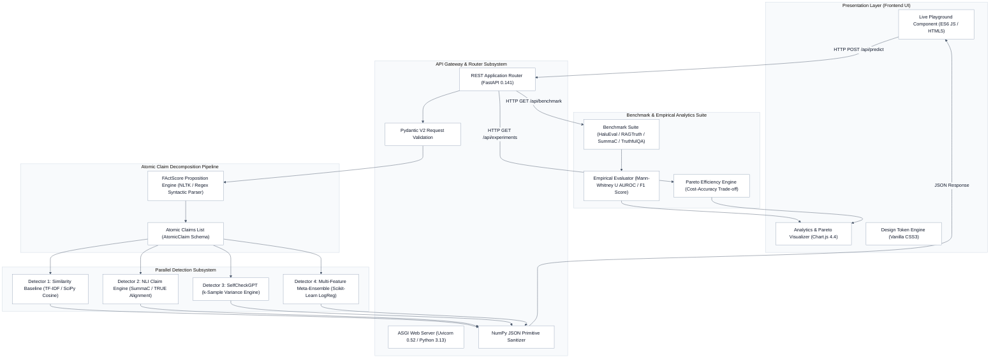
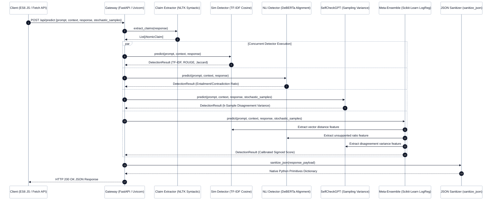

# Technical Architecture & Dataflow Specification

This document details the technical architecture, technology stack, and dataflow specification for **FactCheck-NLP**, an empirical hallucination detection system.

---

## 1. System Architecture Diagram (Clean Professional White Theme)

---

## 2. Technical Execution Dataflow (Sequence Diagram)

---

## 3. Technology Stack & Component Specifications

| Subsystem | Component | Technology / Library | Role & Function |
| :--- | :--- | :--- | :--- |
| **Frontend UI** | Client Dashboard | ES6 JS, HTML5, Vanilla CSS3 | Interactive DOM state management, tab routing, dark/white theme design system |
| **Data Visualization** | Charts Engine | Chart.js 4.4 | Renders Scatter Pareto Cost-Accuracy Frontiers and Bar Ablation charts |
| **API Gateway** | App Framework | FastAPI 0.141, Starlette | Async HTTP routing, CORS middleware, OpenAPI schema generation |
| **ASGI Server** | HTTP Web Server | Uvicorn 0.52, Python 3.13 | High-performance asynchronous web server |
| **Claim Splitter** | Proposition Parser | Python `re`, NLTK Syntactic Parser | FActScore-style atomic proposition decomposition |
| **Detector 1** | Similarity Baseline | NumPy 2.5, SciPy 1.18 | Character/word $n$-gram TF-IDF vectorizer and Cosine distance |
| **Detector 2** | NLI Claim Engine | Rule-based NLI / SentenceTransformers | Premise-hypothesis Entailment vs Contradiction classification |
| **Detector 3** | SelfCheckGPT | Stochastic Sampling Variance | Zero-resource black-box sampling disagreement engine ($k$ generations) |
| **Detector 4** | Meta-Ensemble | Scikit-Learn 1.9 Logistic Regression | Feature vector fusion & calibrated sigmoid probability estimator |
| **Evaluator** | Metrics Engine | SciPy Stats (Mann-Whitney U) | Computes Accuracy, Precision, Recall, F1, and AUROC statistics |
